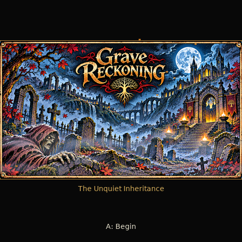
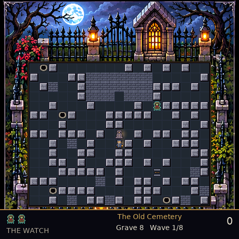
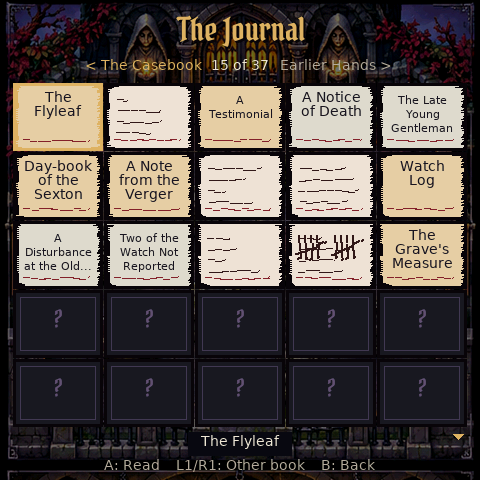

# Grave Reckoning

*The Unquiet Inheritance*

A Victorian Gothic puzzle game for the **SF3500** handheld. You are a revenant, newly risen
in a cemetery that has not forgiven you. The living have come with their lanterns, because
they know you. Push the cemetery's own stones around until every one of them is sealed in,
and the grave is settled.

<p align="center">
  
  
  
</p>

If you remember *Rodent's Revenge*, you already know the idea: push blocks, pin the chasers
against walls and each other, and stay out of the hazards' way. Grave Reckoning wraps that in
thirty graves across six chapters, a story told in comic pages, an investigator's Journal full
of things better left unread, and a soundtrack that is all its own.

## What you get

- **30 graves in six chapters**, each with its own architecture: a flooded burial ground, an old
  cemetery, an ossuary, a family crypt, a ruined chapel and an ancestral mausoleum.
- **Three vigils** (difficulties): *The Mourners* (easy), *The Watch* (normal) and *The Faithful*
  (hard), each with its own number, speed and temperament of pursuers.
- **A story in comic pages** that opens as you settle each chapter.
- **The Journal**: a casebook kept by an investigator who is following your story, and a second
  book of **Earlier Hands**, written by the keepers who held it before. Pages come loose as you play.
  Read carefully. The investigator's handwriting does not stay steady.
- **An original soundtrack**, a pair of tracks for each chapter, and sound effects for every stone,
  bell and fall.
- **Options for the squeamish and the picky**: sound effects, screen effects and hints can each be
  switched off, and the walls can be recoloured.

## Installing

Grave Reckoning is built for the SF3500's Ports menu. Download the latest zip from the
[Releases](https://github.com/Kryptikone316/Grave-Reckoning/releases) page and unzip it into the
`roms/ports` folder on the SD card, so that you end up with:

```
roms/ports/Grave Reckoning.sh
roms/ports/gravereckoning/        (the game and everything it needs)
```

Then pick **Grave Reckoning** from the Ports list. Your progress and settings are saved inside
the `gravereckoning` folder. When updating, copy the new files over the old ones and leave
`options.dat`, `progress.dat` and `highscores.dat` alone, and you will keep your place.

## Controls

| Button | Does |
|---|---|
| D-pad | Move (four ways) and navigate menus |
| A or START | Select |
| B | Back |
| L1 / R1 | Switch tabs in Options, vigils in the Book of the Interred, books in the Journal |
| START in a grave | Pause ("Between Graves") |
| SELECT + START | Quit immediately |

## How to play

- You are on a 19×15 board of stones. Stones can be pushed, and a pushed stone shoves the ones
  behind it. Walls never move.
- The living chase you directly and cut corners, so a diagonal gap is an open door. If one touches
  you, you lose a return (you start with three) and rise again.
- **Seal a pursuer in** by surrounding it with stones on every side. Once *every* pursuer on the
  board is sealed, the bell tolls and they become blue flames. Gather the flames for points. A
  stone that shifts and opens a gap wakes a sealed pursuer, so plan the rite.
- **Open graves** swallow pursuers who walk or are pushed into them, though they leave nothing
  behind. They also hold *you* for a few seconds, so mind your footing.
- **Mantraps and rolling skulls** are fatal. They are rare on Easy and common on Hard.
- New pursuers arrive in **waves** whether or not the last batch is dead. Clear the board after the
  last wave and the grave is settled.
- If you wall yourself in with no way out, the game says so and offers a fresh start.
- Each grave you settle earns progress toward an extra return.

Layouts are fixed, so a retry is the same puzzle. Only the pursuers' starting squares vary, so
a grave is something you can learn.

## The vigils

| | The Mourners (Easy) | The Watch (Normal) | The Faithful (Hard) |
|---|---|---|---|
| Pursuers | few, a step every 2.4 s | more, a step every 1.6 s | many, a step every 1.1 s |
| Time between waves | long | medium | short |
| Hazards | late and few | scaled by grave | plentiful |
| Pursuers who stumble into graves | often | sometimes | rarely |

Settle the last grave of a vigil to see how the story ends. The settled graves are marked in the Book
of the Interred with a brass dot, and a blue flame if you settled one without losing a return.
**Continue** on the main menu takes you to the first grave you have not settled.

## Options

- **Sound:** music volume, mute, sound effects, and a speaker blend. (The SF3500's speakers do not
  play the left channel, so on the speakers the game mixes both sides together. Headphones always
  get true stereo.)
- **Look:** wall colour (each chapter's own, or one of ten), screen effects and hints.
- **Story:** how often the comic pages appear, the title picture, and a replay of the prologue.

## Tips

- Use the walls. A pursuer against a wall, and especially in a corner, needs far fewer stones to seal in.
- The bell only tolls when *every* pursuer on the board is sealed, so corral them before you finish the rite.
- Graves are traps for them too. A chain of stones can push a chaser straight in.
- On the Faithful vigil, think a move ahead. The Watch is for learning, and the Mourners is for the
  story.

## Known issues and notes

- Balance is still being tuned. The pursuers were just slowed down. If a grave feels unfair, or too
  easy, please say so in the [issues](https://github.com/Kryptikone316/Grave-Reckoning/issues).
- The SF3500 has no real-time clock, so anything that depends on the date (there is one small
  surprise on April 1st) depends on the date you have set on the device.
- A credits screen is planned. Credits are below for now.

## Credits and licences

Grave Reckoning is **free software and free culture**.

- **Code:** MIT licence (`LICENSE`).
- **Art, story, Journal text, music, sound effects and level designs:** original work by the
  project owner, released into the public domain under CC0 1.0 (`LICENSE-ASSETS.txt`). Use, change
  and share it freely, with no credit required.
- **Fonts:** Pirata One, UnifrakturCook and Covered By Your Grace (SIL Open Font License 1.1) and
  Bitstream Vera. They ship unmodified, with their licences.
- **Libraries in the package:** libogg and Tremor (Xiph.org Foundation, BSD-style licence).
- Every third-party item and its licence is listed in `THIRD-PARTY-NOTICES.txt`, which ships in the
  game folder.
- **Inspiration:** *Rodent's Revenge* (Microsoft Entertainment Pack, 1991) and Maxx Boehme's Java
  remake [*A Mouse's Vengeance*](https://github.com/maxxboehme/A_Mouses_Vengeance). Grave Reckoning is
  a new game in that tradition and contains none of their art or level data.

## For developers

Build instructions, the rules in detail, difficulty numbers, the test tools, the story and Journal
file formats and the art pipeline are in **[DEV-NOTES.md](DEV-NOTES.md)**.
